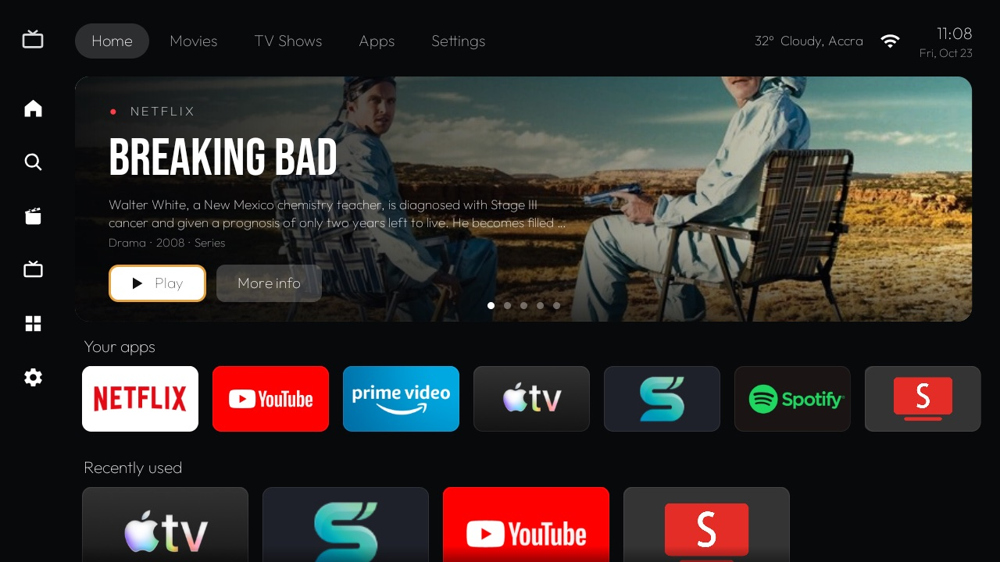
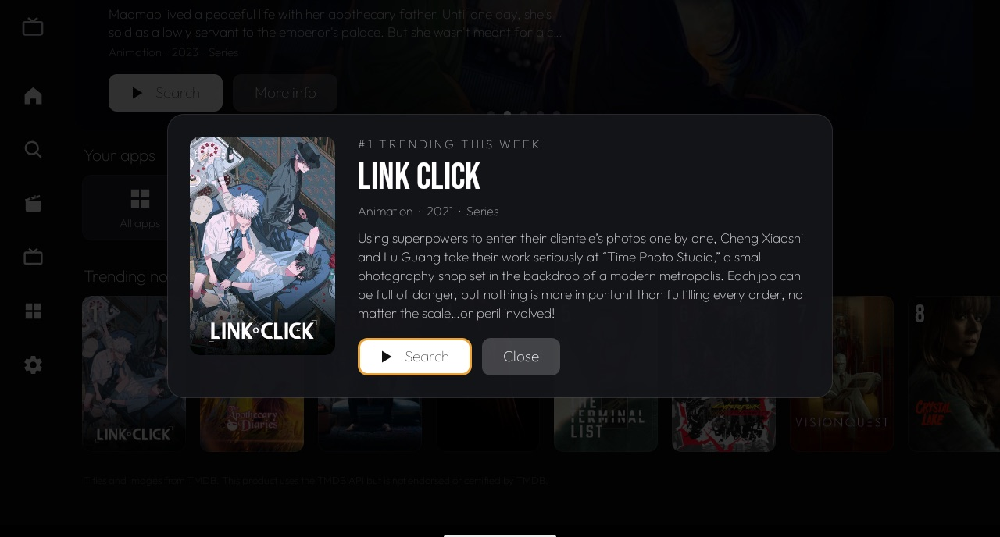
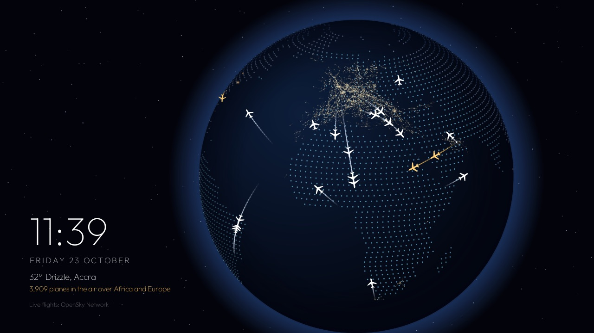
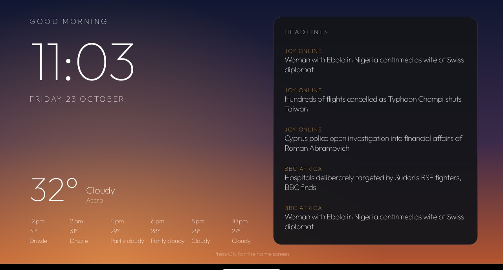

# Android TV Home

Made by [@bigkobi92-svg](https://github.com/bigkobi92-svg).

A clean, ad-free home screen for Android TV, with a phone remote, a night-globe screensaver with flying
planes, and a morning screen with weather and headlines. Built and tested on a TCL UnionTV running
Android TV 9, but it works on most Android TV and Google TV sets.

No root, nothing flashed, and everything can be undone with one script.



## What you get

**Home screen**
- Side menu and tabs (Home, Movies, TV Shows, Apps, Settings), weather and clock.
- A big rotating banner of what's popular **on the streaming apps you have, in your country**
  (Netflix, Apple TV, Prime Video), with wide film stills from TMDB.
- **Play** opens the show directly in Netflix when its Netflix ID is known (looked up on Wikidata).
- Rows for **Your apps**, **Recently used** (from the TV's own usage record) and **Trending now**.
- **Movies** and **TV Shows** pages: the Top 10 on Netflix, Apple TV and Prime Video in your country, with
  the poster on the left of the banner.
- **Now playing** card in the banner whenever music plays in the background (Spotify, YouTube Music...):
  song, artist, album cover and previous / pause / next.
- **More info** panel with the full description. All apps grid. HDMI / Live TV inputs menu.



**Night globe screensaver**
- The Earth lit by the real sun for the current time, city lights on the night side.
- Animated airliners flying between real cities with contrails, plus the real live air traffic over
  Africa and Europe (from the free OpenSky Network) as a soft glow.

 · [10-second clip](docs/screensaver.mp4)

**Morning screen**
- Wakes the TV at a set time (6:00 by default): big clock, weather now and for the next hours, and
  the top headlines. Stays on for 30 minutes, then the TV goes back to its normal screensaver.



**Phone remote**
- Open `http://<your TV's IP>:8765` on any phone on the same Wi-Fi and pair once with a 4-digit code
  shown on the TV. Open apps, switch HDMI inputs, volume, search, Home, screensaver, morning screen.
- Add it to your phone's home screen to use it like an app.
- Arrows, OK, Back and power still need the TV remote or the Google TV app: Android only lets those
  press keys on the TV.

**Debloat (optional)**
- A list of TCL tracking, ads and leftover apps to switch off, with a one-line undo.

## Honest limits

- **Continue watching with progress bars isn't possible.** Netflix, YouTube and Apple TV keep that
  private; only Google's own home screen may read it. You get "Recently used" apps instead.
- **Play** jumps straight to the title in **Netflix** (and Apple TV, untested) only when Wikidata has the
  title's ID. Otherwise it opens the app. Prime Video always opens on its home page.
- The trending lists are **TMDB's**, not your personal recommendations.
- On some TVs the stock home screen has to be switched off for this one to stay as Home
  (the install script does that, and `tools/restore.sh` switches it back).

## What you need

- An Android TV or Google TV (not Samsung Tizen, LG webOS or Fire TV).
- A Mac or PC on the same Wi-Fi with **JDK 17+** and the **Android SDK** (Android Studio installs both).
- Optional but recommended: a free **TMDB API key** for the banner and trending rows.

## Set up

1. **On the TV:** Settings → Device Preferences → About → press OK on **Build** 7 times. Go back to
   **Developer options** and turn on **USB debugging**. Note the TV's IP address
   (Settings → Network → your Wi-Fi).
2. **TMDB key (optional):** make a free account at [themoviedb.org](https://www.themoviedb.org/), open
   Settings → API, request a Developer key, then add this line to `launcher/local.properties`
   (create the file if it isn't there; it's never committed):
   ```
   tmdb.api.key=your32characterkey
   ```
3. **Make it yours:** edit `launcher/app/src/main/res/values/config.xml`. Set your city and its latitude and
   longitude for the weather, your country code for streaming (`watch_region`, e.g. GH, US, GB),
   the apps for "Your apps", the morning time and news feeds.
4. **Build and install:**
   ```bash
   TV_HOST=192.168.1.50 launcher/build-and-install.sh
   ```
   Accept the **"Allow USB debugging?"** prompt on the TV the first time.
5. **Debloat (optional, TCL Android TV 9 list):**
   ```bash
   TV_HOST=192.168.1.50 tools/disable.sh
   ```
   Check the list first; other brands need their own. Undo everything with `tools/restore.sh`.

## Troubleshooting

- **"Could not load video" in Apple TV, or casting fails:** the TV's copy-protection storage may be
  damaged (it was on ours). `tools/widevine-check` shows whether Widevine is provisioned. A factory reset
  fixed it for us; afterwards clear the Apple TV app's data and sign in again.
- **Netflix opens on "Who's watching?"** the first time after a restart: pick a profile, then Play
  works normally.
- **No planes yet:** the first live-flight download can take up to 45 seconds; after that the TV keeps a
  saved copy so the screensaver shows planes at once.
- **Phone can't find the remote:** check the phone is on the same Wi-Fi, and give your TV a fixed IP in
  your router so the address doesn't change.

## Credits

- Created by [@bigkobi92-svg](https://github.com/bigkobi92-svg).
- Started from [Gathin23/tv-vibehack](https://github.com/Gathin23/tv-vibehack) (MIT), which also
  inspired the debloat approach.
- Titles and images: [TMDB](https://www.themoviedb.org/). This product uses the TMDB API but is not
  endorsed or certified by TMDB.
- Weather: [Open-Meteo](https://open-meteo.com/). Live flights: [OpenSky Network](https://opensky-network.org/).
  Netflix and Apple TV IDs: [Wikidata](https://www.wikidata.org/). Fallback charts: iTunes RSS.
  Headlines: Joy Online and BBC Africa RSS feeds. World map: [world-atlas](https://github.com/topojson/world-atlas) (Natural Earth).
- Fonts: Outfit and Bebas Neue, both under the SIL Open Font License (see `launcher/FONTS.md`).

Netflix, YouTube, Apple TV, Prime Video and Spotify are trademarks of their owners. This project isn't
affiliated with any of them.

## Licence

MIT © 2026 [@bigkobi92-svg](https://github.com/bigkobi92-svg). Includes work from
[Gathin23/tv-vibehack](https://github.com/Gathin23/tv-vibehack) (MIT). See [LICENSE](LICENSE).
